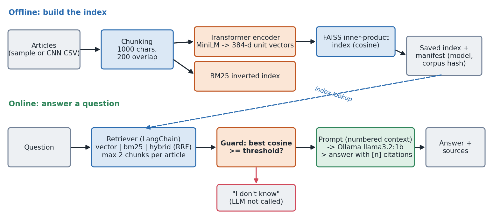

# Retrieval-Augmented Question Answering (RAG) with Transformers, LangChain and Ollama

A question-answering system over news articles. A **Transformer encoder** (MiniLM) turns text into vectors, **FAISS** and a hand-written **BM25** retrieve the relevant passages (dense, lexical or **hybrid**), a **LangChain (LCEL)** chain gives them to a local LLM served by **Ollama**, and a guard makes the system **refuse questions the articles cannot answer** instead of inventing an answer.

**Tags:** `rag` · `retrieval-augmented-generation` · `transformers` · `sentence-transformers` · `langchain` · `ollama` · `llm` · `faiss` · `bm25` · `hybrid-search` · `information-retrieval` · `nlp` · `python`

> **Background.** This project is based on the Information Retrieval course project in which I built a search engine and a RAG system over CNN news articles. This repository is a cleaned-up, tested and measured rewrite of the RAG part: I fixed the defects I found in my original code (see the implementation guide, section 5), added BM25 and hybrid retrieval, a refusal guard, and an evaluation, and replaced hard-coded paths and the downloaded dataset with a bundled sample corpus.

## Documentation

| PDF | Content |
|---|---|
| [`docs/Assignment.pdf`](docs/Assignment.pdf) | The project brief: aim, tasks, constraints, deliverables, assessment criteria and common pitfalls. |
| [`docs/Implementation_Guide.pdf`](docs/Implementation_Guide.pdf) | How it works (encoder vs decoder Transformers, chunking, BM25, rank fusion, the chain and the guard), the defects fixed in the original code, the tests, all results with their caveats, and limitations. |

## Quick start

```bash
pip install -e .                      # Python 3.10+; LangChain, FAISS, transformers, torch (a few GB)
ollama pull llama3.2:1b               # install Ollama first: https://ollama.com
python -m ir_rag ask "What interest rate did the central bank set?" --compare
```

```
RAG answer (2.7s):
The central bank set an interest rate of 3.75 percent [1].

Sources:
  [1] Central bank cuts interest rate by a quarter point (doc-012, cosine 0.58)
  [2] Inflation falls to 3.1 percent as food prices ease (doc-011, cosine 0.33)
  ...

LLM-only answer (2.5s):
I'm not aware of any specific information about a central bank setting an interest rate. Can you provide more context ...
```

The first run downloads the MiniLM weights (about 90 MB) from Hugging Face; later runs reuse them and the saved index.

| Command | What it does |
|---|---|
| `python -m ir_rag index` | build (or reuse) and save the chunk index |
| `python -m ir_rag ask "..." [--mode vector\|bm25\|hybrid] [--compare]` | answer a question with sources; `--compare` also shows the LLM-only answer |
| `python -m ir_rag evaluate retrieval` | BM25 vs vector vs hybrid metrics (no LLM needed) |
| `python -m ir_rag evaluate rag` | RAG vs LLM-only answers (needs Ollama running) |
| `python -m unittest discover -s tests -t .` | the 42 tests (no LLM needed) |

**Your own data.** The CNN articles dataset from Kaggle (*cnn-articles-after-basic-cleaning*) is not included. Download it and run `python -m ir_rag ask "..." --corpus path/to/CNN_Articels_clean.csv`.

## What is in the box

* **`TransformerEmbeddings`**: MiniLM run through `transformers`, with mean pooling and L2 normalisation written out by hand (a test checks it against `sentence-transformers`).
* **`BM25Index`**: Okapi BM25 with an inverted index, stop words and a light stemmer (a test checks the score against a hand calculation).
* **`HybridRetriever`**: a LangChain retriever with three modes, `vector`, `bm25` and `hybrid` (reciprocal rank fusion), and a per-article cap on returned chunks.
* **`RAGPipeline`**: an LCEL chain, a numbered-context prompt with citations, an Ollama LLM, and an evidence guard.
* **Index persistence** with a manifest, so an index built from a different corpus, model or chunk size is never reused by mistake.
* **Evaluation**: 26 labelled questions over 40 bundled fictional articles (invented events, so the model cannot answer from memory): Hit@k, Recall@k, MRR, nDCG for each retriever, and fact recall and refusal behaviour for RAG versus the bare LLM.



## Results (summary)

Measured on the bundled corpus with `llama3.2:1b`; details and caveats are in the implementation guide.

| Retrieval (20 answerable questions) | Hit@1 | MRR |
|---|---|---|
| dense (vector) | 0.90 | 0.93 |
| BM25 | 0.65 | 0.74 |
| hybrid (equal weights) | 0.75 | 0.84 |

BM25 matches dense retrieval when the question shares words with the article and is much worse on paraphrases (MRR 0.48 against 0.94). **Hybrid retrieval did not beat dense retrieval on this small corpus**, so `vector` is the default; hybrid is implemented and measured, not assumed to be better.

| Answers (26 questions) | RAG | LLM alone |
|---|---|---|
| required facts found (20 answerable) | 75% | 10% |
| refuses the 6 unanswerable questions | 83% | 17% |

Two failures are worth knowing about: my first prompt made the 1B model refuse 95% of answerable questions (fixed by choosing the prompt on a separate dev set), and the guard's similarity threshold cannot perfectly separate answerable from unanswerable questions, so a question about the Bank of Japan still got an answer built from an article about a different central bank.

## Repository layout

```
src/ir_rag/       data, chunking, embeddings, bm25, retrievers, chain, evaluate, cli
src/ir_rag/resources/   the bundled sample corpus and the labelled questions
tests/            42 unit tests (stub LLM and offline embeddings; one test loads the real MiniLM weights)
scripts/          select_prompt.py, check_original_chunking.py, make_figures.py
results/          evaluation results as JSON, and figures
docs/             Assignment.pdf, Implementation_Guide.pdf
```

## Notes

* **Windows and OpenMP.** PyTorch and FAISS each ship an OpenMP runtime and abort with `OMP: Error #15` when both are loaded. The package sets Intel's documented `KMP_DUPLICATE_LIB_OK=TRUE` workaround on Windows (set it to `FALSE` yourself to opt out). It is unsupported by Intel; the tests check the numerical output of both libraries.
* **Security.** LangChain stores FAISS indexes with pickle. Only load an index that you built yourself.
* **Models.** Everything runs locally; any Ollama model can be used with `--model`.

## License

MIT, see [`LICENSE`](LICENSE). © 2026 Evangelos Tempelopoulos.
